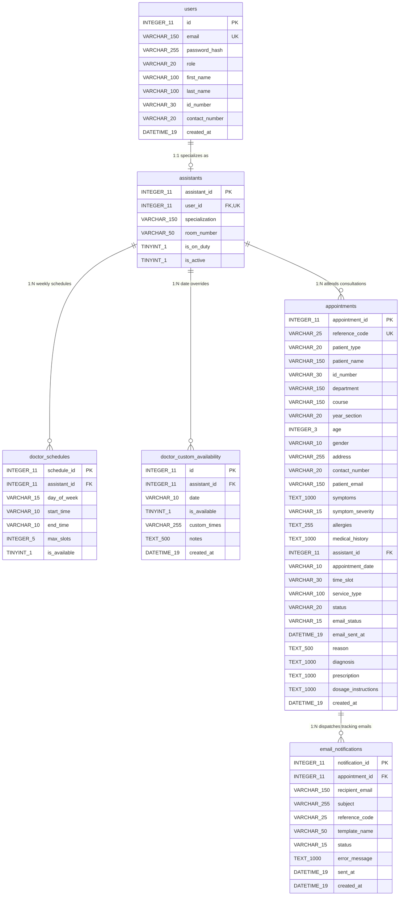

# EARIST Health Services Clinic Appointment System
## Comprehensive Database Data Dictionary (With Data Type Lengths)
_Document Version: 1.2 | Date: October 2026 | Database Engine: SQLite (`node:sqlite`)_

---

### Table of Contents
1. [Overview & Database Architecture](#1-overview--database-architecture)
2. [Entity Relationship Diagram (ERD)](#2-entity-relationship-diagram-erd)
3. [Table Specifications & Field Dictionaries](#3-table-specifications--field-dictionaries)
   - [3.1 Table: `users`](#31-table-users)
   - [3.2 Table: `assistants`](#32-table-assistants)
   - [3.3 Table: `doctor_schedules`](#33-table-doctor_schedules)
   - [3.4 Table: `doctor_custom_availability`](#34-table-doctor_custom_availability)
   - [3.5 Table: `appointments`](#35-table-appointments)
   - [3.6 Table: `email_notifications`](#36-table-email_notifications)
4. [Enum & Domain Value Lookups](#4-enum--domain-value-lookups)
5. [Integrity Rules & Foreign Key Constraints](#5-integrity-rules--foreign-key-constraints)

---

## 1. Overview & Database Architecture

The **EARIST Health Services Clinic Appointment System** database manages campus health consultations for Eulogio "Amang" Rodriguez Institute of Science and Technology (EARIST - Manila). It supports public patient appointment scheduling (for both Students and Faculty/Staff), triage assessment, doctor duty schedules, clinical consultation records, prescriptions, and an **automated notification and tracking mechanism** using unique Reference Tracking IDs (`reference_code`) and email notification dispatch logging (`email_notifications`).

### Database Properties
- **Database Engine**: Native Node.js `node:sqlite` (SQLite 3 compatible)
- **Primary Database File**: `earist_clinic.db`
- **Character Encoding**: UTF-8
- **Foreign Key Enforcement**: `PRAGMA foreign_keys = ON;`
- **Key Identifiers**: Standardized EARIST Tracking Reference Codes (e.g., `EAR-XXXX-XXX` or `EAR-YYYY-ANN`)

---

## 2. Entity Relationship Diagram (ERD)

---

## 3. Table Specifications & Field Dictionaries

### 3.1 Table: `users`
- **Description**: Stores authentication credentials, administrative roles, and profiles for clinic personnel (Medical Doctors, Registered Nurses/Assistants, and Health Services Administrators).
- **Primary Key**: `id`

| Field Name | Data Type (Length) | Nullable | Key / Constraint | Default | Description & Purpose | Sample Value |
| :--- | :--- | :---: | :---: | :---: | :--- | :--- |
| `id` | INTEGER (11) | NO | PK, AUTOINCREMENT | None | Unique internal user account identifier. | `1` |
| `email` | VARCHAR (150) | NO | UNIQUE | None | Official institutional login email address. | `dr.bob@earist.edu.ph` |
| `password_hash` | VARCHAR (255) | NO | None | None | Bcrypt salted hash (cost factor 10) for authentication. | `$2a$10$7...` |
| `role` | VARCHAR (20) | NO | CHECK (`role IN ('assistant', 'admin')`) | None | System permission level: 'assistant' (Doctor/Nurse) or 'admin' (Director). | `assistant` |
| `first_name` | VARCHAR (100) | NO | None | None | Given name of the staff member. | `Dr. Roberto` |
| `last_name` | VARCHAR (100) | NO | None | None | Surname / family name of the staff member. | `Williams` |
| `id_number` | VARCHAR (30) | YES | None | NULL | Official EARIST employee/faculty ID code. | `MED-2026-008` |
| `contact_number` | VARCHAR (20) | YES | None | NULL | Active mobile or clinic landline extension. | `0919-444-5566` |
| `created_at` | DATETIME (19) | YES | None | `CURRENT_TIMESTAMP` | Account registration timestamp (YYYY-MM-DD HH:MM:SS). | `2026-10-20 10:16:00` |

---

### 3.2 Table: `assistants`
- **Description**: Extended professional profile for medical practitioners, physicians, and clinic attendants. Maps 1-to-1 to a corresponding `users` record.
- **Primary Key**: `assistant_id`
- **Foreign Key**: `user_id` &rarr; `users(id)` ON DELETE CASCADE

| Field Name | Data Type (Length) | Nullable | Key / Constraint | Default | Description & Purpose | Sample Value |
| :--- | :--- | :---: | :---: | :---: | :--- | :--- |
| `assistant_id` | INTEGER (11) | NO | PK, AUTOINCREMENT | None | Unique primary key identifying the doctor/assistant profile. | `1` |
| `user_id` | INTEGER (11) | NO | FK, UNIQUE | None | Foreign key linking to the authenticating user account in `users`. | `2` |
| `specialization` | VARCHAR (150) | YES | None | NULL | Clinical field or medical designation. | `General Physician & Campus Triage` |
| `room_number` | VARCHAR (50) | YES | None | NULL | Physical clinic room or station assignment at EARIST Clinic. | `Main Clinic Rm 101` |
| `is_on_duty` | TINYINT (1) | YES | CHECK (0 or 1) | `1` | Flag indicating whether practitioner is currently on active duty (1 = Yes, 0 = Off). | `1` |
| `is_active` | TINYINT (1) | YES | CHECK (0 or 1) | `1` | Soft-state flag for active roster status (1 = Active, 0 = Inactive). | `1` |

---

### 3.3 Table: `doctor_schedules`
- **Description**: Recurring weekly schedule templates that define standard consultation availability windows for each doctor.
- **Primary Key**: `schedule_id`
- **Foreign Key**: `assistant_id` &rarr; `assistants(assistant_id)` ON DELETE CASCADE

| Field Name | Data Type (Length) | Nullable | Key / Constraint | Default | Description & Purpose | Sample Value |
| :--- | :--- | :---: | :---: | :---: | :--- | :--- |
| `schedule_id` | INTEGER (11) | NO | PK, AUTOINCREMENT | None | Unique identifier for the recurring schedule block. | `1` |
| `assistant_id` | INTEGER (11) | NO | FK | None | Foreign key referencing the assigned doctor in `assistants`. | `1` |
| `day_of_week` | VARCHAR (15) | NO | None | None | Day of duty (`Monday`, `Tuesday`, `Wednesday`, `Thursday`, `Friday`). | `Monday` |
| `start_time` | VARCHAR (10) | NO | None | None | Shift start time in 24-hour HH:MM format. | `08:00` |
| `end_time` | VARCHAR (10) | NO | None | None | Shift end time in 24-hour HH:MM format. | `12:00` |
| `max_slots` | INTEGER (5) | YES | None | `15` | Maximum total patient booking capacity allowed per shift block. | `15` |
| `is_available` | TINYINT (1) | YES | CHECK (0 or 1) | `1` | Schedule toggle: 1 if active, 0 if disabled. | `1` |

---

### 3.4 Table: `doctor_custom_availability`
- **Description**: Overrides for specific calendar dates, allowing doctors to schedule official leaves, seminar attendances, holiday blackouts, or customized hours.
- **Primary Key**: `id`
- **Foreign Key**: `assistant_id` &rarr; `assistants(assistant_id)` ON DELETE CASCADE
- **Unique Constraint**: `(assistant_id, date)`

| Field Name | Data Type (Length) | Nullable | Key / Constraint | Default | Description & Purpose | Sample Value |
| :--- | :--- | :---: | :---: | :---: | :--- | :--- |
| `id` | INTEGER (11) | NO | PK, AUTOINCREMENT | None | Unique primary key for the availability override record. | `1` |
| `assistant_id` | INTEGER (11) | NO | FK | None | Foreign key referencing the doctor in `assistants`. | `1` |
| `date` | VARCHAR (10) | NO | None | None | Specific calendar date formatted as `YYYY-MM-DD`. | `2026-10-24` |
| `is_available` | TINYINT (1) | YES | CHECK (0 or 1) | `1` | 0 = Doctor is unavailable/on leave; 1 = Custom available hours. | `0` |
| `custom_times` | VARCHAR (255) | YES | None | NULL | JSON string or text defining modified consultation slot windows. | `["09:00 - 11:30"]` |
| `notes` | TEXT (500) | YES | None | NULL | Administrative reason for custom schedule or absence. | `Attending DepEd-CHED Health Summit` |
| `created_at` | DATETIME (19) | YES | None | `CURRENT_TIMESTAMP` | Record creation timestamp. | `2026-10-20 11:00:00` |

---

### 3.5 Table: `appointments`
- **Description**: Central operational table storing all patient consultations, self-reported symptoms, doctor triage decisions, diagnoses, e-prescriptions, and **tracking ID process delivery placeholders**.
- **Primary Key**: `appointment_id`
- **Foreign Key**: `assistant_id` &rarr; `assistants(assistant_id)` ON DELETE CASCADE

| Field Name | Data Type (Length) | Nullable | Key / Constraint | Default | Description & Purpose | Sample Value |
| :--- | :--- | :---: | :---: | :---: | :--- | :--- |
| `appointment_id` | INTEGER (11) | NO | PK, AUTOINCREMENT | None | Unique internal primary key for the appointment. | `1` |
| `reference_code` | VARCHAR (25) | NO | UNIQUE | None | **Tracking ID (Reference Code)** issued to patient for tracking consultation status online. | `EAR-2026-A109` |
| `patient_type` | VARCHAR (20) | YES | CHECK (`patient_type IN ('student', 'faculty_staff')`) | `'student'` | Category of the campus constituent. | `student` |
| `patient_name` | VARCHAR (150) | NO | None | None | Complete legal full name of the patient. | `John Christian Doe` |
| `id_number` | VARCHAR (30) | NO | None | None | Student Number (e.g. `234-0000M`) or Faculty Employee ID. | `234-0000M` |
| `department` | VARCHAR (150) | NO | None | None | Enrolled College (e.g. `College of Engineering (CEN)`) or Faculty Office. | `College of Engineering (CEN)` |
| `course` | VARCHAR (150) | YES | None | NULL | Academic Degree Program (nullable for faculty/staff). | `BS Computer Engineering` |
| `year_section` | VARCHAR (20) | YES | None | NULL | Year level & section code (e.g., `3-B`). | `3-B` |
| `age` | INTEGER (3) | YES | None | NULL | Patient's age in completed years. | `20` |
| `gender` | VARCHAR (10) | YES | None | NULL | Gender identity (`Male`, `Female`, `Other`). | `Male` |
| `address` | VARCHAR (255) | YES | None | NULL | Residential or dormitory address in Metro Manila. | `123 Pureza St., Sampaloc, Manila` |
| `contact_number` | VARCHAR (20) | NO | None | None | Primary active phone number for emergency contact & SMS. | `0920-555-7788` |
| `patient_email` | VARCHAR (150) | YES | None | NULL | **Patient Email Address** &mdash; Placeholder where Tracking ID and appointment receipts are delivered. | `john.doe.student@earist.edu.ph` |
| `symptoms` | TEXT (1000) | YES | None | NULL | Self-reported complaints or comma-separated symptom tags. | `Severe headache, Dizziness, High fever` |
| `symptom_severity` | VARCHAR (15) | YES | CHECK (`symptom_severity IN ('Mild', 'Moderate', 'Severe')`) | `'Mild'` | Preliminary triage priority level assessed during booking. | `Moderate` |
| `allergies` | TEXT (255) | YES | None | NULL | Known hypersensitivities or allergic reactions (e.g., Penicillin, NSAIDs). | `Penicillin` |
| `medical_history` | TEXT (1000) | YES | None | NULL | Chronic illnesses, prior surgeries, or pertinent medical conditions. | `History of migraines during exam periods` |
| `assistant_id` | INTEGER (11) | NO | FK | None | Foreign key linking to the attending doctor in `assistants`. | `1` |
| `appointment_date` | VARCHAR (10) | NO | None | None | Scheduled consultation date in `YYYY-MM-DD` format. | `2026-10-22` |
| `time_slot` | VARCHAR (30) | NO | None | None | Allocated consultation window (e.g. `09:00 AM - 09:30 AM`). | `09:00 AM - 09:30 AM` |
| `service_type` | VARCHAR (100) | NO | None | None | Clinic clinical category (General Medical Consultation, Dental, etc.). | `General Medical Consultation` |
| `status` | VARCHAR (20) | YES | CHECK (`status IN ('Pending', 'Approved', 'OnGoing', 'Completed', 'Cancelled')`) | `'Approved'` | Life cycle status of the appointment ticket. | `OnGoing` |
| `email_status` | VARCHAR (15) | YES | CHECK (`email_status IN ('Pending', 'Sent', 'Failed')`) | `'Pending'` | **Tracking Email Dispatch Status** &mdash; Indicates whether tracking ID was sent via email. | `Sent` |
| `email_sent_at` | DATETIME (19) | YES | None | NULL | **Tracking Email Timestamp** &mdash; Exact date and time the tracking notification was dispatched. | `2026-10-22 05:32:48` |
| `reason` | TEXT (500) | YES | None | NULL | Patient-stated reason or chief complaint for visiting clinic. | `Feeling dizzy and high temp since morning` |
| `diagnosis` | TEXT (1000) | YES | None | NULL | Official medical assessment entered by the attending doctor. | `Tension headache secondary to dehydration` |
| `prescription` | TEXT (1000) | YES | None | NULL | Prescribed medications, dosages, and pharmaceutical orders. | `Paracetamol 500mg, Oral Rehydration Salts` |
| `dosage_instructions` | TEXT (1000) | YES | None | NULL | Directions for medication administration and patient home care. | `Take 1 tab every 6 hrs as needed. Bed rest.` |
| `created_at` | DATETIME (19) | YES | None | `CURRENT_TIMESTAMP` | Initial booking submission timestamp. | `2026-10-22 05:30:00` |

---

### 3.6 Table: `email_notifications`
- **Description**: Automated email notification queue and audit outbox. Stores email tracking logs, tracking codes dispatched to patients, delivery statuses, error diagnostics, and timestamps.
- **Primary Key**: `notification_id`
- **Foreign Key**: `appointment_id` &rarr; `appointments(appointment_id)` ON DELETE CASCADE

| Field Name | Data Type (Length) | Nullable | Key / Constraint | Default | Description & Purpose | Sample Value |
| :--- | :--- | :---: | :---: | :---: | :--- | :--- |
| `notification_id` | INTEGER (11) | NO | PK, AUTOINCREMENT | None | Unique primary key identifying the email dispatch log. | `1` |
| `appointment_id` | INTEGER (11) | NO | FK | None | Foreign key referencing the parent appointment in `appointments`. | `1` |
| `recipient_email` | VARCHAR (150) | NO | None | None | Destination email address where the tracking ID notification was directed. | `john.doe.student@earist.edu.ph` |
| `subject` | VARCHAR (255) | NO | None | None | Outgoing email subject line. | `EARIST Clinic Appointment Confirmation - Tracking ID: EAR-2026-A109` |
| `reference_code` | VARCHAR (25) | NO | None | None | The tracking reference code embedded in the email for patient tracking. | `EAR-2026-A109` |
| `template_name` | VARCHAR (50) | YES | None | `'appointment_tracking_id'` | Email template identifier used for body formatting. | `appointment_tracking_id` |
| `status` | VARCHAR (15) | YES | CHECK (`status IN ('Pending', 'Sent', 'Failed')`) | `'Pending'` | Current delivery state of the notification (`Pending`, `Sent`, `Failed`). | `Sent` |
| `error_message` | TEXT (1000) | YES | None | NULL | Detailed error or SMTP response log if delivery failed. | NULL |
| `sent_at` | DATETIME (19) | YES | None | NULL | Exact timestamp when the email was transmitted through SMTP/mailer. | `2026-10-22 05:32:48` |
| `created_at` | DATETIME (19) | YES | None | `CURRENT_TIMESTAMP` | Queue creation timestamp. | `2026-10-22 05:30:00` |

---

## 4. Enum & Domain Value Lookups

### 4.1 User Roles (`users.role`)
- `assistant`: Medical staff, attending physicians, dentists, or registered triage nurses. Has access to the Doctor/Staff Queue, Medical Records, Diagnosis & Rx writing, and Availability Calendars.
- `admin`: Health Services Director and clinic administrators. Has access to clinic-wide analytics, staff scheduling rosters, consultation registries, and CSV exports.

### 4.2 Patient Types (`appointments.patient_type`)
- `student`: Enrolled EARIST undergraduate or graduate student. Requires Student ID, College, Course, and Year & Section.
- `faculty_staff`: EARIST professors, instructors, administrative personnel, or campus maintenance staff. Requires Faculty/Staff ID and Department.

### 4.3 Symptom Severity / Triage (`appointments.symptom_severity`)
- `Mild`: Routine check-ups, non-urgent symptoms, medical clearance renewals, mild allergies.
- `Moderate`: Acute pain, persistent low-grade fever, moderate migraines, toothaches requiring urgent cleaning or extraction.
- `Severe`: High fever, severe trauma, acute respiratory distress, severe lacerations (flagged for immediate priority consultation).

### 4.4 Appointment Status Life Cycle (`appointments.status`)
1. `Approved`: Default confirmed state upon public booking. Ready in clinic daily queue.
2. `OnGoing`: Patient has been called by the doctor into the consultation room; vitals and diagnosis are currently being entered.
3. `Completed`: Consultation finalized; medical findings, prescription, and instructions recorded.
4. `Cancelled`: Appointment cancelled by patient or staff. Reopens capacity for other patients.
5. `Pending`: Used for provisional bookings requiring administrative clearance (optional workflow).

### 4.5 Email Notification Status (`appointments.email_status` & `email_notifications.status`)
- `Pending`: Email message queued in database outbox; awaiting background mailer dispatch with the patient's tracking ID.
- `Sent`: Email successfully delivered to patient's inbox; tracking link and reference code provided.
- `Failed`: Delivery attempt unsuccessful (e.g. invalid domain, network failure); error logged in `email_notifications.error_message`.

---

## 5. Integrity Rules & Foreign Key Constraints

1. **Cascade Deletions (`ON DELETE CASCADE`)**:
   - Deleting a `users` record automatically purges their associated `assistants` profile.
   - Deleting an `assistants` profile automatically cascades and cleans up `doctor_schedules`, `doctor_custom_availability`, and `appointments`.
   - Deleting an `appointments` record automatically purges any related `email_notifications` outbox entries.

2. **Uniqueness Constraints**:
   - `users.email`: Enforces unique email credentials per clinic account.
   - `assistants.user_id`: Enforces strict 1-to-1 relationship between user accounts and doctor profiles.
   - `doctor_custom_availability(assistant_id, date)`: Prevents contradictory availability overrides for the same doctor on any given calendar date.
   - `appointments.reference_code`: Guarantees that every tracking code generated is globally unique across the clinic database.

3. **Concurrency & Capacity Rules**:
   - Maximum 5 patients per doctor per 30-minute consultation window (`MAX_SLOT_CAPACITY = 5`).
   - Duplicate booking prevention restricts a patient (`id_number`) from occupying more than one appointment on the same date and time slot.

---
_Data Dictionary maintained by EARIST Clinic Development Team. Generated for database audit, compliance, and systems integration._
