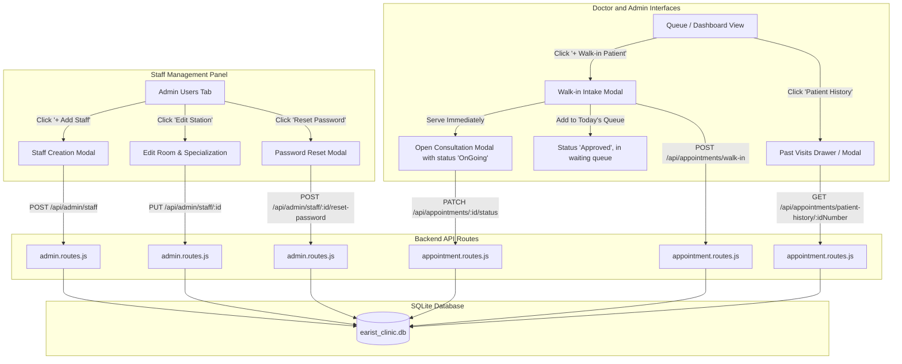

# Clinical Triage, Walk-In Intake & Directorate Staff Management Design

## 1. Overview & Goals

This specification details the architecture and requirements for extending the EARIST Clinic Appointment System with two essential operational subsystems:

1. **Clinical Triage & Walk-In Intake (Option A):** Instant walk-in patient registration, vital signs recording with clinical alert thresholds, and patient past clinic visits history lookup.
2. **Directorate Staff Management (Option D):** Full administrative CRUD capabilities for campus doctors and medical officers, including account creation, station assignment, profile editing, and password reset.

---

## 2. Architecture & Data Flow



---

## 3. Database Schema Changes (`backend/src/config/db.js`)

The `appointments` table will be upgraded via safe SQLite column migrations:

- `bp_systolic` INTEGER (e.g., 120)
- `bp_diastolic` INTEGER (e.g., 80)
- `temperature` REAL (e.g., 36.8)
- `pulse_rate` INTEGER (e.g., 75)
- `respiratory_rate` INTEGER (e.g., 18)
- `spo2` INTEGER (e.g., 98)
- `weight_kg` REAL (e.g., 55.5)
- `is_walkin` INTEGER DEFAULT 0 (1 if walk-in, 0 if booked online)

Migration logic will inspect `PRAGMA table_info(appointments);` and conditionally execute `ALTER TABLE appointments ADD COLUMN ...` for each missing field, ensuring zero data loss and backwards compatibility.

---

## 4. Backend Endpoints Specifications

### 4.1 Walk-In Intake Endpoint

- **Route:** `POST /api/appointments/walk-in`
- **Access:** Protected (`assistant`, `admin`)
- **Request Body:**
  ```json
  {
    "patient_type": "student",
    "patient_name": "Juan Dela Cruz",
    "id_number": "234-1234M",
    "department": "College of Engineering",
    "course": "BSME",
    "year_section": "3-A",
    "age": 20,
    "gender": "Male",
    "contact_number": "09123456789",
    "email": "juan@earist.edu.ph",
    "symptoms": "High fever, dizziness, headache",
    "symptom_severity": "Moderate",
    "allergies": "None",
    "assistant_id": 1,
    "serve_immediately": true,
    "bp_systolic": 125,
    "bp_diastolic": 82,
    "temperature": 38.4,
    "pulse_rate": 88,
    "spo2": 97,
    "weight_kg": 62
  }
  ```
- **Response:**
  ```json
  {
    "success": true,
    "message": "Walk-in patient registered successfully.",
    "appointment_id": 42,
    "reference_code": "EAR-WLK-9012",
    "status": "OnGoing"
  }
  ```

### 4.2 Patient History Lookup Endpoint

- **Route:** `GET /api/appointments/patient-history/:idNumber`
- **Access:** Protected (`assistant`, `admin`)
- **Behavior:** Queries `appointments` matching `UPPER(TRIM(id_number)) = UPPER(TRIM(?))` ordered by `appointment_date DESC, created_at DESC`.
- **Response:**
  ```json
  {
    "success": true,
    "id_number": "234-1234M",
    "total_visits": 3,
    "history": [
      {
        "appointment_id": 35,
        "appointment_date": "2026-10-15",
        "symptoms": "Acute Migraine",
        "diagnosis": "Tension headache secondary to lack of sleep",
        "prescription": "Paracetamol 500mg #2 tabs",
        "dosage_instructions": "Take 1 tab every 4-6 hrs as needed",
        "doctor_name": "Dr. Roberto Williams",
        "status": "Completed"
      }
    ]
  }
  ```

### 4.3 Update Consultation Status & Vitals

- **Route:** `PATCH /api/appointments/:id/status`
- **Access:** Protected (`assistant`, `admin`)
- **Enhancement:** Accepts updated vital signs (`bp_systolic`, `bp_diastolic`, `temperature`, `pulse_rate`, `spo2`, `weight_kg`) alongside `diagnosis`, `prescription`, and `dosage_instructions`.

### 4.4 Directorate Staff Management Endpoints

- **`POST /api/admin/staff`**
  - Protected (`admin` only)
  - Validates required fields: `first_name`, `last_name`, `email`, `role` (`assistant`), `specialization`, `room_number`.
  - Generates bcrypt hash for initial password (defaults to `earist2026!` if omitted).
  - Creates `users` record and corresponding `assistants` record in an atomic SQLite transaction.
  - Initializes default Mon-Fri weekly schedule slots in `doctor_schedules`.
- **`PUT /api/admin/staff/:assistantId`**
  - Protected (`admin` only)
  - Updates staff room number, specialization, on-duty status, and active status.
- **`POST /api/admin/staff/:assistantId/reset-password`**
  - Protected (`admin` only)
  - Resets the target user's password to `earist2026!` or admin-specified string.

---

## 5. Frontend User Experience & Components

### 5.1 Doctor & Admin Dashboards — Walk-In Intake Modal (`WalkInModal.jsx`)

- Accessible via high-contrast `+ Walk-In Patient` button in the action bar.
- Form fields:
  - Patient Classification: Students, Academic/Non-Academic, Outsource/Extension.
  - Identity: Full Name, Student/Employee ID Number, College/Unit, Section, Contact.
  - Triage: Chief Complaints & Symptoms.
  - Initial Vitals Section: BP, Temp, Pulse, SpO₂, Weight.
  - Action Buttons:
    1. **"Serve Immediately"** (Red gradient): registers patient, sets status to `OnGoing`, and pops open the Consultation modal immediately.
    2. **"Add to Waiting Queue"** (Slate button): adds patient to today's active waiting queue with status `Approved`.

### 5.2 Consultation Modal Vitals & Triage Alerts

- Inside the Consultation Modal (`DoctorDashboard.jsx`), a dedicated **Vital Signs Grid** displays:
  - BP (`Systolic / Diastolic mmHg`)
  - Temp (`°C`)
  - Heart Rate (`BPM`)
  - $\text{SpO}_2$ (`%`)
  - Weight (`kg`)
- Dynamic Warning Badges:
  - 🔴 **High Fever Alert:** Triggered if temperature $\ge 37.8^\circ\text{C}$.
  - 🔴 / 🟡 **Hypertension Warning:** Triggered if Systolic $\ge 140$ or Diastolic $\ge 90$.
  - 🔴 **Hypoxemia Warning:** Triggered if $\text{SpO}_2 < 95\%$.

### 5.3 Patient Past Visit History Modal (`PatientHistoryModal.jsx`)

- Added as an instant lookup button (`History` with clock icon) on queue cards and inside the consultation view.
- Displays a chronological timeline of all previous consultations for that student ID, showing past diagnoses, medications dispensed, and attending doctor names.

### 5.4 Directorate Staff Management Panel (`AdminDashboard.jsx`)

- Upgrades the **Users Directory** tab into an active management dashboard:
  - Action Bar: `+ Add Clinic Medical Officer / Staff` button.
  - Table row actions:
    - ✏️ **Edit Station:** Modal to update Room Number, Specialization, and Contact.
    - 🔑 **Reset Password:** Confirmation modal resetting password to `earist2026!` with clear instructions to notify the staff member.
    - ⚡ **Toggle Duty / Status:** Active/Inactive switch with safety checks.

---

## 6. Constraints & Non-Goals

- **Non-Goals:**
  - No public student self-service password reset (handled via clinic admin or direct ticket tracking).
  - No real-time WebSocket requirement (polling every 15s is already established and optimal for SQLite concurrency).
- **Constraints:**
  - Styling must maintain EARIST institutional identity (Crimson `#800020`, dark maroon `#580016`, amber `#D97706`).
  - No AI visual artifacts (zero blur orbs, zero sparkles icons).
  - Maximum viewport accessibility for 1366x768 screens with scrollable modal viewports.
