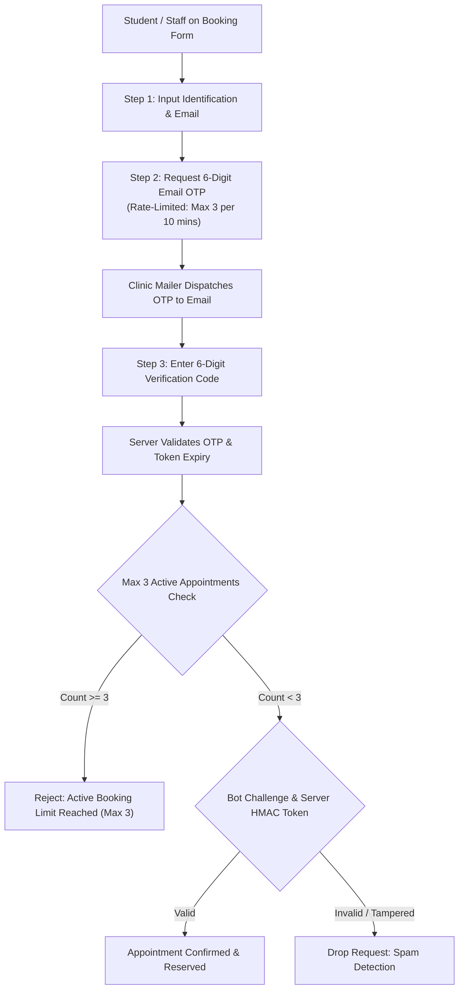

# Design Specification: Clinic Appointment Security, Anti-Spam & Outsider Mitigation

**Date:** 2026-11-05  
**Topic:** EARIST Clinic Security Hardening & Bot/Spam Protection  
**Status:** Approved by User  
**Scope:** Strict Clinic Appointment Security & Data Privacy Compliance  

---

## 1. Threat Model & Vulnerability Analysis

The EARIST Clinic Appointment System operates as a direct-booking portal for students, faculty, and outsource personnel without requiring account registration. While this minimizes friction, open endpoints introduce 4 primary attack vectors:

1. **Scripted Bot Flooding (Denial of Service):** Automated scripts consuming all doctor slots across the week, blocking legitimate campus community members.
2. **Outsider / Non-Campus Infiltration:** Unauthorized individuals outside EARIST using up campus health resources.
3. **Slot Hoarding & Identity Forgery:** Individuals booking multiple slots using fabricated or stolen Student/Employee ID numbers.
4. **Email Bombing & Information Scraping:** Abusing open booking/tracking endpoints to spam victim emails or harvest student PII (Personally Identifiable Information).

---

## 2. Security Defense-in-Depth Architecture



---

## 3. Core Mitigation Modules

### 3.1 6-Digit Email OTP Verification (Outsider & Fake Email Elimination)
- **Mechanism:** Before an appointment is saved to the database, the patient must verify their email with a 6-digit one-time passcode.
- **Workflow:**
  1. Patient enters their email on the booking form.
  2. Patient clicks **"Send Verification Code"** (or automatically triggered at Step 4).
  3. Server generates cryptographically random 6-digit code, hashes it with salt, and stores it in `email_verifications` with a 10-minute TTL.
  4. NodeMailer dispatches an official EARIST Clinic security email.
  5. The booking is only committed if the supplied OTP matches the active unexpired code.
- **Impact:** Completely eliminates automated spam bots and fake non-existent email reservations.

### 3.2 Active Appointment Cap (Max 3 per ID)
- **Rule:** A single Student or Personnel ID number (`id_number`) can hold a maximum of **3 active upcoming appointments** (status: `Pending`, `Approved`, `CheckedIn`, `OnGoing`).
- **Enforcement:**
  ```sql
  SELECT COUNT(*) as count FROM appointments 
  WHERE id_number = ? AND appointment_date >= CURRENT_DATE 
    AND status IN ('Pending', 'Approved', 'CheckedIn', 'OnGoing');
  ```
  If `count >= 3`, request is rejected with HTTP 403: *"You already have 3 active clinic appointments on record (Limit: 3). Please complete or cancel an existing appointment before booking another."*

### 3.3 Server-Signed Cryptographic Anti-Bot Token (Replacing Client-Side Math)
- **Vulnerability Solved:** Client-side plaintext challenges (`botNum1 + botNum2`) are replaced.
- **Mechanism:**
  - Endpoint `GET /api/appointments/security-challenge` generates a server-signed challenge:
    - `challenge_id`: UUID
    - `question`: "What is 7 + 15?"
    - `signature`: `HMAC-SHA256(question + answer + timestamp + secret)`
  - Submitting `public-book` requires the `challenge_id`, answer, and HMAC signature. Tampering or spoofing fails instantly.

### 3.4 Rate Limiting & Abuse Prevention
- **IP Rate Limiting:**
  - `POST /api/appointments/send-otp`: 3 requests per 10 minutes per IP/email.
  - `POST /api/appointments/public-book`: 5 successful bookings per hour per IP.
  - `GET /api/appointments/track/:reference`: 20 queries per 5 minutes per IP.
- **Honeypot Trap:** Hidden CSS-concealed input field (`website_hp`) remains active; any bot autofilling it is silently discarded.

### 3.5 Public Tracking Privacy Masking (RA 10173 Compliance)
- **Vulnerability Solved:** Previously, anyone with a student ID or reference code could view full phone numbers, emails, and home addresses.
- **Redaction Policy:**
  - If requester is public (not an authenticated doctor/admin):
    - Phone: `0912****789`
    - Email: `j***e@earist.edu.ph`
    - Address: Hidden / `"[Protected for Student Privacy]"`
  - Full details remain accessible only to medical staff inside `DoctorDashboard` and `AdminDashboard`.

---

## 4. Database Schema Migrations

```sql
CREATE TABLE IF NOT EXISTS email_verifications (
  id INTEGER PRIMARY KEY AUTOINCREMENT,
  email TEXT NOT NULL,
  otp_code TEXT NOT NULL,
  expires_at DATETIME NOT NULL,
  attempts_left INTEGER DEFAULT 3,
  is_verified INTEGER DEFAULT 0,
  created_at DATETIME DEFAULT CURRENT_TIMESTAMP
);

CREATE INDEX IF NOT EXISTS idx_email_verif_lookup ON email_verifications(email, otp_code);
```

